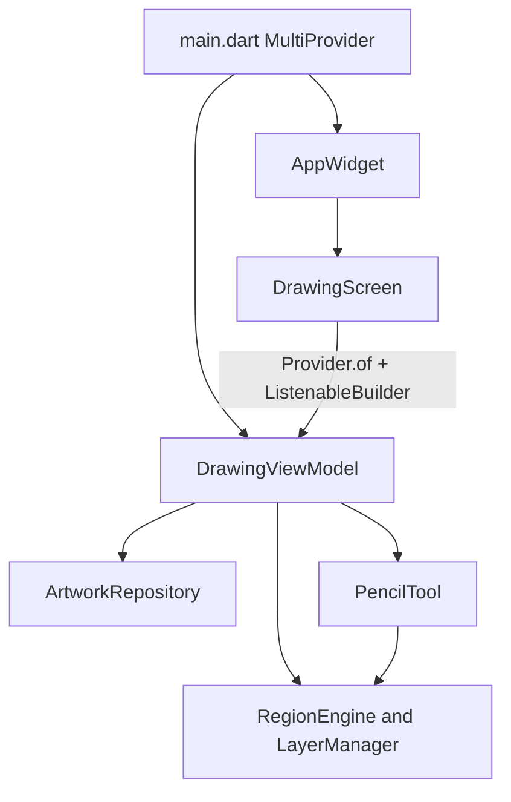

# Kids Drawing

Flutter prototype of a children's coloring app for iOS and Android. A stroke is freehand paint clipped to the closed part under the first touch. The product is built around that region-constrained painting.

This repository is the Flutter prototype. An equivalent React Native + Skia build is planned so both can be benchmarked on the same devices, artwork, and stroke sequences. The production framework stays open until that comparison exists.

## Status

The app launches into a landscape coloring session:

Splash → Category → Gallery → [`DrawingScreen`](lib/features/drawing/screen/drawing.screen.dart.dart)

In this tree:

- Pencil coloring on the apple-and-books page (vector regions in [`apple.and.books.local.dart`](lib/data/local/artwork/apple.and.books.local.dart))
- Stick color choice, density brush size, undo/redo
- Pinch zoom and pan with painting kept in canvas coordinates
- Finger-lift burst
- Clear-all erase confirm
- One `DrawingViewModel` for the process, created in `MultiProvider` at launch

Still later: marker, brush, bucket, crayon, and wand paint engines; a stroke eraser; sounds; save and export; padlocked colors. The live shell is `AppWidget` in [`lib/main.dart`](lib/main.dart).

Frame-rate and latency targets are written in [docs/Memory.md](docs/Memory.md). They are goals, not measured results.

## Run

Requires the Flutter SDK with Dart `^3.13.7` ([`pubspec.yaml`](pubspec.yaml)).

```bash
flutter pub get
flutter run
flutter analyze
```

The drawing workspace is landscape. The app is a `CupertinoApp`. Route widgets use `CupertinoPageScaffold` and `CupertinoPageRoute`. Keep Material `Scaffold`, `AppBar`, and `ElevatedButton` out of this app.

## How a session is wired

`main.dart` creates one `DrawingViewModel` inside `MultiProvider` / `ChangeNotifierProvider` and passes `AppWidget` as the child. The drawing screen does not construct the session and does not receive an artwork id on the route.

| Caller | Intent |
|---|---|
| Gallery | `selectArtwork`, then push the drawing screen |
| Stick rail | `selectTool`, `selectCategory` |
| Density slider | `setDensity` |
| Erase confirm | `clearAll` |

The screen reads the view model with `Provider.of` (`listen: false`) and rebuilds through `ListenableBuilder`. `DrawingViewModel` owns the artwork repository, `selectedArtworkId`, `selectedTool`, `selectedCategory`, `density`, the active `DrawingTool`, `RegionEngine`, and `LayerManager`.

Paint behavior lives in [`pencil.drawing.tool.dart`](lib/core/tools/pencil.drawing.tool.dart) (`PencilTool`). Stick colors live in [`pencil.tool.dart`](lib/core/tools/pencil.tool.dart) (`PencilTools`). Those are different types. The engine does not import a concrete tool.



Folder and import rules are in [docs/Architecture.md](docs/Architecture.md).

## Drawing invariants

A change to input, clipping, or history has to keep these:

- The closed part under the first touch clips the whole stroke. There is no region-mode toggle and no selection step.
- A first touch on an outline, or on paper beside the art, picks the nearest part within 22 screen points, converted with the current zoom. A touch farther than that from every part paints nothing. Inner detail lines (leaf vein, book lines, apple shine) sit inside a part and do not block the pick.
- A later stroke can cover earlier paint in the same part. Outlines stay above paint.
- One completed stroke is one undo step. Redo stays disabled until an undo.
- On finger lift, a burst of shapes appears near the stroke and fades in about 1.5 seconds. The burst is display-only: it is not written into the document and it is not an undo step.
- Two fingers zoom and pan the page. Stored points stay in canvas coordinates, so painting stays aligned while zoomed. Pinching back out animates to the fitted page.
- The density slider sets the size of later strokes to `12 + density * 44`.
- The eraser control opens a full-screen confirm. YES calls `clearAll`. NO dismisses the confirm. This is a page clear, not a stroke eraser.
- The landscape tools column reads notch side from `NativeDeviceOrientationReader`. The `State` that owns that reader must not call `setState`; a rebuild restarts orientation waiting and the flex layout jumps.

## Repository map

```text
lib/
  main.dart                              # binding, MultiProvider, AppWidget
  core/engine/                           # region hit-test, layers, dabs, burst, view transform
  core/tools/                            # DrawingTool, PencilTool, stick catalogs
  core/ui/                               # theme and widgets used by more than one feature
  state/drawing/drawing.view-model.dart  # session
  data/                                  # models, local artwork, artwork repository
  features/splash/
  features/category/
  features/gallery/
  features/drawing/
    screen/drawing.screen.dart.dart      # active route
    screen/erase.confirm.screen.dart
    widgets/workspace.canvas.dart
    widgets/workspace.painter.dart
    widgets/tools/
```

`core/` does not import `app/`, `state/`, or `features/`. A screen may use its view model, its own widgets, `core/ui`, and `data/models`. It does not import `data/local`, repository implementations, or `core/storage`.

## Stack

| Package | Role |
|---|---|
| `provider` | `DrawingViewModel` lifetime and lookup |
| `native_device_orientation` | Notch side for the landscape tool column |
| `flutter_svg` | SVG assets |
| `cupertino_icons` | Icon font |

Strokes are drawn with Flutter `Canvas` / `CustomPainter`. There is no third-party drawing engine.

## Documentation

| Doc | What it holds |
|---|---|
| [docs/Memory.md](docs/Memory.md) | Confirmed decisions and current status |
| [docs/Architecture.md](docs/Architecture.md) | Folders, imports, and MVVM ownership |
| [docs/PRD.md](docs/PRD.md) | Product requirements and prototype scope |
| [docs/TRD.md](docs/TRD.md) | Input, stroke model, clipping, and rendering constraints |
| [docs/UI-UX.md](docs/UI-UX.md) | Controls, gestures, and the erase confirm |
| [docs/Design.md](docs/Design.md) | Figma reference notes |
| [docs/Rules.md](docs/Rules.md) | Contributor and assistant working rules |

Record a confirmed decision in `docs/Memory.md`. Editor rules for this repo live in `.cursor/rules/`.

## Working on the code

A new paint tool is a new class in `core/tools/` that implements `DrawingTool`. Tool behavior does not grow a `switch` in the engine or the view model.

Before adding a class or widget, search `core/ui`, `core/engine`, `core/tools`, `data/models`, and `data/repositories` and extend what is already there.

Profile release builds on physical devices before treating a frame-rate or latency number as a result. The numeric targets in Memory.md are the bar to measure against.
