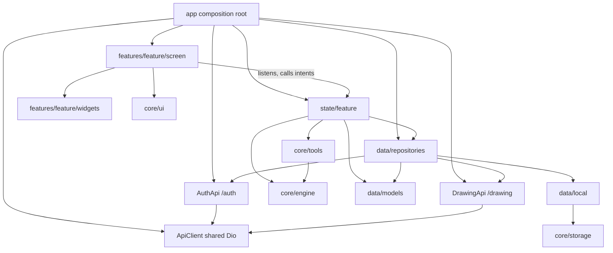

# Architecture — Kids Drawing App

**Status:** Initial technical baseline  
**Platforms:** iOS and Android  
**Prototype strategy:** Flutter first, then an equivalent React Native + Skia prototype. No production framework decision is made until both are benchmarked.

## 1. Architectural goals
- Natural, responsive freehand drawing.
- Accurate region-constrained painting with no bleed.
- Rendering independent from presentation widgets.
- Editable strokes/layers, undo/redo and offline persistence.
- High-resolution export.
- Measurable performance on physical devices.

## 2. Layered architecture
1. **Presentation:** screens, toolbar, brush picker, palette, gestures and accessibility.
2. **Application/state:** drawing session, commands, undo/redo, selection and document lifecycle.
3. **Domain:** document, layer, region, stroke and brush models.
4. **Rendering engine:** input sampling, stroke construction, brush rendering, clipping, compositing, caching and hit testing.
5. **Infrastructure:** artwork loading, persistence, asset decoding and export.

The UI sends normalized input and commands to the engine. It must not implement brush geometry or region clipping.

## 3. Folder structure (MVVM)

Create a folder only when the first file needs it. Forbidden names: `utils`, `helpers`, `common`, `misc`, `shared`. Existing `lib/features/models`, `lib/features/state`, `lib/features/engine`, and `lib/features/data` paths are legacy; leave them in place until a refactor is approved. AI coding rules live in `.cursor/rules/`.

```text
lib/
  main.dart                         # bootstrap only: WidgetsFlutterBinding, runApp
  app/                              # the only folder allowed to import every layer
    app.dart                        # CupertinoApp, theme, home: SplashScreen
    app.router.dart                 # route table, one class
    app.dependencies.dart           # composition root: Dio, stores, repos, viewmodels
  core/                             # imports nothing from app, state, data, features
    ui/
      theme/                        # colors, spacing, text styles, theme
      widgets/                      # widgets used by two or more features
    engine/                         # shared drawing logic used by every tool
    tools/                          # one class per drawing tool (DrawingTool)
      drawing.tool.dart
      pencil.tool.dart              # first tool; add others when built
    storage/                        # abstract interfaces only; no concrete DB yet
  state/                            # ViewModels (ChangeNotifier); mirrors feature names
    <feature>/
      <feature>.viewmodel.dart
  data/                             # never imports state, features, or Flutter widgets
    models/
    api/
      api.client.dart               # shared Dio (base URL, timeouts, interceptors)
      api.exception.dart
      auth/                         # example: AuthApi instance for /auth
      drawing/                      # example: DrawingApi instance for /drawing
    local/
      <resource>/
        <resource>.local.dart
    repositories/
      <resource>/
        <resource>.repository.dart
        <resource>.repository.impl.dart
        <resource>.mapper.dart      # only when mapping is real work
  features/
    <feature>/
      screen/
        <feature>.screen.dart       # route View: CupertinoPageScaffold, layout and wiring only
      widgets/                      # canvas, toolbar, palette — one widget per file
assets/
  artwork/
  brushes/
  stickers/
  backgrounds/
test/
integration_test/
docs/
```

Placement: `screen/` is the route widget only. Route widgets use `CupertinoPageScaffold` and navigate with `CupertinoPageRoute`. Do not use `Scaffold`, `AppBar`, or `ElevatedButton` under `CupertinoApp`. Shared drawing logic lives in `core/engine`. Each tool is one class in `core/tools` (pencil, brush, crayon, marker, watercolor, spray paint, glitter, pattern, paint bucket, sticker). Do not add empty tool or API files. Wire `Dio`, stores, repositories, and ViewModels only in `app/app.dependencies.dart`.

### MVVM mapping



- `app/` is the only folder that may import every layer. `main.dart` only calls `runApp`.
- A screen may import `state/<its feature>/`, its own `widgets/`, `core/ui/`, and `data/models`. It never imports `data/api`, `data/local`, repository implementations, or `core/storage`.
- A ViewModel imports `foundation.dart` and `dart:ui` only from Flutter. It receives a repository interface through its constructor.
- `data/` never imports `state/`, `features/`, `material.dart`, or `cupertino.dart`.
- `core/` never imports `app/`, `state/`, `data/`, or `features/`.
- `core/tools` may import `core/engine`. The engine never imports a concrete tool.
- Offline-first: the repository reads local first and syncs with the API. The ViewModel does not know which source answered.
- One API client instance per URL group (`AuthApi` → `/auth`, `DrawingApi` → `/drawing`; examples until those APIs exist). Shared `Dio` lives in `ApiClient`.

Legacy mapping when a refactor is approved: `features/models` → `data/models`; `features/data` → `data/repositories/<resource>/`; `features/state/drawing.controller.dart` → `state/drawing/drawing.viewmodel.dart`; `features/engine` → `core/engine`; `drawing.page.dart` → `features/drawing/screen`; other drawing widgets → `features/drawing/widgets`.

## 4. Core domain objects
- **DrawingDocument:** stable ID, schema version, artwork ID, logical canvas dimensions, ordered layers and metadata.
- **DrawingLayer:** ID, name, type, visibility, opacity, blend mode, order and content.
- **DrawingRegion:** stable ID, artwork ID, closed path/mask, bounds, z-order, paintable flag and optional semantic name.
- **DrawingStroke:** ID, layer ID, brush snapshot, color, points and optional region ID.
- **BrushConfig:** type, color, size, opacity, spacing, hardness/texture parameters and dynamics.

Point samples may include position, timestamp, pressure, tilt and orientation when available.

## 5. Coordinate spaces
Use explicit screen, canvas and artwork coordinate spaces. Convert screen input to canvas coordinates using the inverse canvas transform. Store strokes in canvas coordinates. Store region paths in artwork coordinates and transform them consistently. Never persist raw screen coordinates.

## 6. Rendering pipeline
1. Receive pointer/stylus samples.
2. Convert to canvas coordinates.
3. Filter noisy samples while preserving corners and timing.
4. Construct a path or brush-dab sequence.
5. Render to the active paint layer.
6. Apply the selected region clip when region mode is active.
7. Composite paint layers.
8. Draw artwork outlines/foreground details above paint.
9. Present the frame.

Region clipping must use the actual closed path or mask, not a rectangular bounding box.

## 7. Layers and artwork
Typical back-to-front stack:
1. Background.
2. Paint layers.
3. Stickers/objects.
4. Artwork outline/foreground details.

Each independently paintable artwork part must be a closed vector path or an equivalent mask with a stable ID. Flattened PNG/JPG alone is insufficient for precise region clipping unless accompanied by separately authored masks.

## 8. State and history
A completed stroke is one undo operation; do not create history entries for every pointer move. Erase, fill, sticker and layer changes are also discrete operations. Define history memory limits and compaction before large sessions.

## 9. Persistence and offline behavior
Persist editable stroke data and document metadata locally. Version the schema, use atomic writes, cache artwork locally, and autosave at safe transaction boundaries. Core drawing must work without network access.

## 10. Export
Render at requested pixel dimensions, independently of screen resolution. Support transparent or solid backgrounds. Composite all visible layers in correct order.

## 11. Framework boundary
Flutter prototype: Flutter Canvas/CustomPainter and platform capabilities. React Native prototype: Skia. Share domain behavior, artwork and acceptance tests; do not force identical internal implementations.

## 12. Performance and observability
Measure input-to-visible latency, frame-time distribution, missed frames, active point count, memory, CPU/GPU where available, export duration, thermal behavior and stability.
Targets (not yet measured): at least 60 FPS on agreed baseline devices, 120 FPS where supported, and an aim of under 20 ms input-to-visible latency.

## 13. Decisions to validate
Vector clips vs raster masks vs hybrid; immediate vs cached rendering; persistence format; pressure/tilt APIs; artwork complexity limits. Decide using profiling and prototype evidence.
