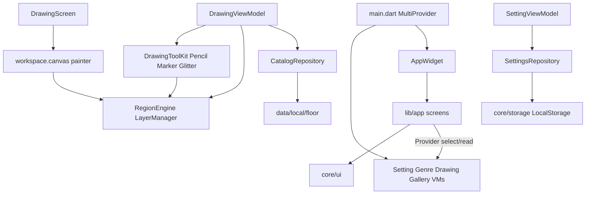

# Architecture — Kids Drawing App

**Status:** Initial technical baseline  
**Platforms:** iOS and Android  
**Prototype strategy:** Flutter first, then an equivalent React Native + Skia prototype. No production framework decision is made until both are benchmarked.

## 1. Architectural goals
- Natural, responsive freehand drawing.
- Accurate region-constrained painting with no bleed.
- Rendering independent from presentation widgets.
- Editable strokes/layers, undo/redo and offline persistence.
- High-resolution export.
- Measurable performance on physical devices.

## 2. Layered architecture
1. **Presentation:** screens, toolbar, brush picker, palette, gestures and accessibility.
2. **Application/state:** drawing session, commands, undo/redo, selection and document lifecycle.
3. **Domain:** document, layer, region, stroke and brush models.
4. **Rendering engine:** input sampling, stroke construction, brush rendering, clipping, compositing, caching and hit testing.
5. **Infrastructure:** artwork loading, persistence, asset decoding and export.

The UI sends normalized input and commands to the engine. It must not implement brush geometry or region clipping.

## 3. Codebase map (live tree)

**Last updated:** 2026-11-20

Single source of truth for file locations. Stack: Flutter `CupertinoApp`, Provider MVVM, Floor SQLite catalog, SharedPreferences settings via `LocalStorage` → `SettingsRepository`. User flow: **Splash → Genre → Gallery → Drawing**; settings from Genre via parent gate → `SettingDialog`.

Create a folder only when the first file needs it. Forbidden folder names: `utils`, `helpers`, `common`, `misc`, `shared` (except existing `lib/utils/responsive.dart`). AI coding rules live in `.cursor/rules/`.

### 3.1 Placement and imports

- `screen/` under each `lib/app/<feature>/` is the route widget only (`CupertinoPageScaffold`, `CupertinoPageRoute`).
- Shared drawing logic: `core/engine/`. Each paint engine: one `DrawingTool` in `core/tools/`. Stick catalogs (`PencilTools`, `MarkerTools`, `GlitterTools`) are separate from paint engines.
- **Live composition root:** `lib/main.dart` — `MultiProvider` wires `CatalogRepository`, `SettingsRepository`, `DrawingViewModel`, `GalleryViewModel`, `GenreViewModel`, `SettingViewModel`.
- Screen imports: its `state/`, own `widgets/`, `core/ui/`, `lib/types/`. Never `data/local` impls or repository impls from screens.
- `data/` never imports `state/`, `app/`, or Flutter UI libraries.
- `core/` never imports `app/` or `state/`. `core/tools` may import `core/engine`; engine never imports a concrete tool.

**When you add, move, rename, or delete any file under `lib/`, update this section and bump Last updated (see §3.6).**

### 3.2 `lib/` annotated files

Presentation routes and widgets: `lib/app/`. Domain types: `lib/types/`. No `lib/features/` in this repo.

#### `lib/` root

- `main.dart` — App entry: Floor DB, device id, catalog seed, MultiProvider (Setting, Genre, Drawing, Gallery), CupertinoApp → SplashScreen.

#### `lib/app/drawing/`

- `app/drawing/metrics/tools.panel.metrics.dart` — Fixed metrics for drawing tools panel column sizing.
- `app/drawing/screen/complete.screen.dart` — Post-drawing completion UI: polaroid preview, keep/let go, save bubble.
- `app/drawing/screen/drawing.screen.dart` — Main landscape coloring session; binds DrawingViewModel to canvas/tools rails.
- `app/drawing/screen/erase.confirm.screen.dart` — Clear-all confirmation sheet; YES clears layers via ViewModel.
- `app/drawing/widgets/actions/clip.mode.button.dart` — Toggles region clip mode affordance on canvas toolbar.
- `app/drawing/widgets/actions/complete.check.button.dart` — Navigates to CompleteScreen when artwork done.
- `app/drawing/widgets/actions/drawing.canvas.actions.dart` — Undo/redo/erase action cluster for canvas column.
- `app/drawing/widgets/canva/canvas.pinch.dart` — Pinch/zoom/pan gesture math; updates CanvasViewTransform.
- `app/drawing/widgets/canva/workspace.canvas.dart` — Pointer input → ViewModel strokes; `glitterTicker` when committed or active glitter; hosts WorkspacePainter.
- `app/drawing/widgets/canva/workspace.painter.dart` — CustomPainter: regions, layers, bursts, glitter twinkle.
- `app/drawing/widgets/complete/complete.action.bar.dart` — Top actions on completion screen.
- `app/drawing/widgets/complete/complete.keep.let.go.bar.dart` — Keep vs Let go pill bar.
- `app/drawing/widgets/complete/complete.polaroid.card.dart` — Polaroid frame with snapshot preview.
- `app/drawing/widgets/complete/complete.saved.bubble.dart` — Saved confirmation bubble UI.
- `app/drawing/widgets/complete/complete.scene.backdrop.dart` — Completion screen decorative backdrop.
- `app/drawing/widgets/controller/controller.tools.dart` — Left column density slider and controller tools.
- `app/drawing/widgets/tools/category.rail.dart` — Stationary category picker rail (pencil/marker/etc.).
- `app/drawing/widgets/tools/drawing.tools.dart` — Right tools column: colors, sticks, category integration.
- `app/drawing/widgets/tools/size.slider.display.dart` — Custom-painted brush size slider display.

#### `lib/app/gallery/`

- `app/gallery/screen/gallery.screen.dart` — Section gallery grid; select artwork → DrawingViewModel.selectArtwork.
- `app/gallery/widgets/gallery.box.item.dart` — Single artwork tile in gallery grid.
- `app/gallery/widgets/gallery.grid.dart` — Grid of GalleryBoxItem for current section.
- `app/gallery/widgets/gallery.section.background.dart` — Section hero/background imagery helpers.

#### `lib/app/genre/`

- `app/genre/screen/genre.screen.dart` — Hub after splash; carousel, live bg from settings, parent gate → settings.
- `app/genre/widget/genre.carousel.dart` — Horizontal genre picker; pushes GalleryScreen.
- `app/genre/widget/genre.circle.item.dart` — One genre circle in carousel.
- `app/genre/widget/genre.live.background.dart` — Animated parallax background when liveBackgroundOn.
- `app/genre/widget/genre.title.dart` — Arched genre title typography widget.

#### `lib/app/parent_gate/`

- `app/parent_gate/screen/ask.grown.up.screen.dart` — Parent math challenge full screen.
- `app/parent_gate/utils/grown.up.math.challenge.dart` — Random equation generation and validation.
- `app/parent_gate/utils/parent.gate.dart` — showDialog wrapper routing to AskGrownUpScreen.
- `app/parent_gate/widgets/grown.up.equation.card.dart` — Equation display and answer chips UI.

#### `lib/app/setting/`

- `app/setting/model/interest.option.dart` — Little Artist interest catalog entry model.
- `app/setting/model/language.entry.dart` — Language flag catalog for LanguagePanel.
- `app/setting/model/setting.section.x.dart` — SettingSection labels, icons, colors extension.
- `app/setting/model/setting_section.dart` — SettingSection enum for nav sections.
- `app/setting/panels/about_panel.dart` — About app card + version via package_info_plus.
- `app/setting/panels/help_panel.dart` — Help placeholder copy.
- `app/setting/panels/language_panel.dart` — Language flag grid; scrollable: false scaffold body.
- `app/setting/panels/little_artist_panel.dart` — Hub rows → gender/age/interests sub-screens.
- `app/setting/panels/music_panel.dart` — Music toggle, volume, track picker rows.
- `app/setting/panels/sounds_voice_panel.dart` — Voice/SFX/vibration toggles.
- `app/setting/panels/subscription_panel.dart` — Subscription ticket UI + paywall placeholder.
- `app/setting/screen/little.artist.age.screen.dart` — Age range picker for Little Artist.
- `app/setting/screen/little.artist.gender.screen.dart` — Gender/siblings picker.
- `app/setting/screen/little.artist.interests.screen.dart` — Multi-select interests grid.
- `app/setting/screen/setting.screen.dart` — SettingDialog modal: glass shell, nav, SizedBox.expand panels.
- `app/setting/widgets/interest.tile.dart` — Selectable interest tile with animation.
- `app/setting/widgets/little.artist.hub.row.dart` — Tappable settings row for Little Artist hub.
- `app/setting/widgets/music.volume.slider.dart` — Styled volume slider for Music panel.
- `app/setting/widgets/paw_print_icon.dart` — Paw vector icon for glass shell decoration.
- `app/setting/widgets/setting.card.dart` — Frosted card container for settings rows.
- `app/setting/widgets/setting.colors.dart` — Setting-specific color tokens.
- `app/setting/widgets/setting.disabled.dart` — Wraps disabled panel sections opacity.
- `app/setting/widgets/setting.nav.dart` — Left inset nav list in settings dialog.
- `app/setting/widgets/setting.panel.scaffold.dart` — Fixed title+close header; scrollable/flex body.
- `app/setting/widgets/setting_glass_shell.dart` — Frosted notebook chrome; paws + puppy; no global close.
- `app/setting/widgets/setting_nav_item.dart` — Single nav row in SettingNav.
- `app/setting/widgets/setting_toggle_row.dart` — Icon + title + Cupertino switch in SettingCard.

#### `lib/app/splash/`

- `app/splash/splash.screen.dart` — 3s splash → replace with GenreScreen.

#### `lib/core/engine/`

- `core/engine/burst.engine.dart` — Finger-lift particle burst; ephemeral not in undo.
- `core/engine/burst.shape.dart` — BurstShape enum for burst particles.
- `core/engine/canvas.engine.dart` — CanvasViewTransform zoom/pan/fit math.
- `core/engine/dab.buffer.dart` — Ring buffer of dab stamps for rendering.
- `core/engine/dab.tip.dart` — Single dab stamp geometry.
- `core/engine/glitter.twinkle.dart` — Loads `shaders/glitter.frag`; twinkle paint for baked/active glitter rasters.
- `core/engine/layer.manager.dart` — Paints layers; bakes `_glitterImage`; active glitter bounds raster + shader twinkle.
- `core/engine/region.engine.dart` — Region hit-test, clip paths, first-touch region pick.
- `core/engine/stroke.dabber.dart` — Converts pointer samples to dab sequence.
- `core/engine/stroke.renderer.dart` — Paints dab buffers and strokes to canvas.

#### `lib/core/storage/`

- `core/storage/database.storage.dart` — Placeholder/reserved; empty file.
- `core/storage/local.storage.dart` — SharedPreferences wrapper for settings keys.

#### `lib/core/tools/`

- `core/tools/drawing.tool.dart` — Abstract DrawingTool paint engine interface.
- `core/tools/drawing.tool.kit.dart` — Resolves active DrawingTool from BrushType.
- `core/tools/glitter.drawing.tool.dart` — GlitterTool: modulate dabs with stick color + neutral grain.
- `core/tools/glitter.textures.dart` — SVG speck threshold or procedural grain tile; `stampCell` 80 (not rail PNGs).
- `core/tools/marker.drawing.tool.dart` — MarkerTool paint engine.
- `core/tools/marker.textures.dart` — Marker tip texture assets.
- `core/tools/marker.tool.dart` — MarkerTools color stick catalog.
- `core/tools/pencil.drawing.tool.dart` — PencilTool paint engine (primary).
- `core/tools/pencils.textures.dart` — Pencil tip textures and lanes.
- `core/tools/stationary.tools.dart` — StationaryTools top-level category catalog.
- `core/tools/stationary/category.tool.stationary.dart` — CategoryTools images for category rail.
- `core/tools/stationary/glitter.tool.dart` — GlitterTools stick catalog.
- `core/tools/stationary/pencil.tool.dart` — PencilTools color stick catalog.

#### `lib/core/ui/`

- `core/ui/theme/app.colors.dart` — App-wide color palette tokens.
- `core/ui/theme/app.theme.dart` — CupertinoThemeData with Nunito defaults.
- `core/ui/theme/app.typography.dart` — boldStyle, semiBoldStyle, numericStyle tokens.
- `core/ui/widgets/circle.button.dart` — Round filled tappable icon/digit button.
- `core/ui/widgets/rounded.button.dart` — Rounded image tile button.

#### `lib/data/`

- `data/local/artwork/artwork.catalog.seeder.dart` — Seeds Floor DB from JSON seeds per device.
- `data/local/artwork/artwork.path.parser.dart` — Parses SVG/path strings into regions.
- `data/local/artwork/artwork.thumbnail.baker.dart` — Renders artwork thumbnails for gallery.
- `data/local/artwork/json.artwork.loader.dart` — Loads coloring JSON into ColoringArtwork.
- `data/local/artwork/strokes.json.codec.dart` — Serialize/deserialize strokes for persistence.
- `data/local/device.id.store.dart` — Stable per-install device id.
- `data/local/floor/app.database.dart` — Floor @Database definition.
- `data/local/floor/app.database.g.dart` — Floor codegen — do not hand-edit.
- `data/local/floor/artwork.dao.dart` — Artwork Floor DAO queries.
- `data/local/floor/artwork.entity.dart` — Artwork table entity.
- `data/repositories/artwork/catalog.repository.dart` — CatalogRepository interface.
- `data/repositories/artwork/catalog.repository.impl.dart` — Floor-backed catalog read/write.
- `data/repositories/gallery/gallery.repository.dart` — Gallery section data (stub/light).
- `data/repositories/genre/artwork/artwork.repository.dart` — Genre artwork placeholder.
- `data/repositories/genre/genre.repository.dart` — Genre list repository.
- `data/repositories/settings/settings.repository.dart` — SettingsRepository interface.
- `data/repositories/settings/settings.repository.impl.dart` — Settings persisted via LocalStorage.
- `data/seed/artwork.seed.catalog.dart` — List of bundled artwork seed entries.
- `data/seed/artwork.seed.entry.dart` — One seed manifest entry.
- `data/seed/school/school.bag.seed.dart` — School bag seed asset refs.
- `data/seed/school/school.eraser.seed.dart` — Eraser seed refs.
- `data/seed/school/school.pencil.seed.dart` — Pencil seed refs.

#### `lib/state/`

- `state/drawing/drawing.view-model.dart` — Drawing session: tool, layers, regions, catalog load.
- `state/gallery/gallery.view-model.dart` — Gallery section selection and navigation helpers.
- `state/genre/genre.view-model.dart` — Genre carousel state.
- `state/setting/setting.view-model.dart` — Settings prefs UI state; loads via SettingsRepository.

#### `lib/types/`

- `types/brush.config.dart` — BrushConfig snapshot on strokes.
- `types/brush.type.dart` — BrushType enum.
- `types/category.model.dart` — CategoryModel for tool categories.
- `types/coloring.artwork.dart` — Loaded artwork: regions, paths, metadata.
- `types/drawing.region.dart` — Closed paintable region model.
- `types/drawing.stroke.dart` — Stroke points, color, regionId, brush.
- `types/gellery/gallery.model.dart` — Gallery section model (note folder spelling).
- `types/genre/genre.model.dart` — Genre carousel item model.
- `types/paint.color.dart` — Paint color wrapper for tools.
- `types/tools/glitter.model.dart` — Glitter stick model.
- `types/tools/pencil.model.dart` — Pencil stick model.
- `types/tools/stationary.model.dart` — Base stick model for catalogs.

#### `lib/utils/`

- `utils/responsive.dart` — context.rs() responsive scaling extension.

### 3.3 `assets/` (folders)

- `assets/fonts/` — Nunito variable font registered in `pubspec.yaml`.
- `assets/brushes/` — Brush category icons (pencil, glitter, paintbrush).
- `assets/gallery/` — Gallery section hero images.
- `assets/genre/live_background/` — Parallax layers for animated genre hub background.
- `assets/marker/`, `assets/pencil/` — Legacy flat marker/pencil stick images.
- `assets/stationary/pencil/`, `assets/stationary/glitter/` — Stationary stick thumbnails used by catalogs.
- `assets/png/` — Shared PNGs (e.g. settings puppy).
- `assets/svgs/` — SVG assets (paw, category backgrounds).

Non-Dart: `shaders/glitter.frag` — Fragment shader twinkle on glitter layer rasters (declared in `pubspec.yaml` `flutter: shaders`).

### 3.4 Project docs and Cursor rules

**`docs/`**

- `Architecture.md` — This file; **§3 is the live codebase map**.
- `Design.md` — Visual design notes.
- `Memory.md` — Product decisions; §3 points here for paths (not a duplicate tree).
- `PRD.md`, `TRD.md` — Product and technical requirements.
- `Roadmap-Stages.md` — Delivery stages.
- `Rules.md` — Human + AI discipline; tree read/update obligations.
- `UI-UX.md` — UX flows and patterns.

**`.cursor/rules/`** (Cursor agents — follow alongside `Rules.md`)

- `architecture.mdc` — Folder layout and import boundaries.
- `coding-standards.mdc` — One unit per file, SOLID, naming.
- `data-layer.mdc` — Data layer constraints.
- `drawing-engine.mdc` — Engine vs UI separation.
- `reuse-first.mdc` — Search before creating widgets.
- `simple-code.mdc` — No clever abstractions in `core/`.
- `typography.mdc` — Nunito + `AppTypography` tokens.
- `ui-screens.mdc` — Screen/widget conventions.
- `viewmodel.mdc` — ViewModel patterns.
- `doc-tree.mdc` — Keep Architecture §3 in sync when `lib/` changes.

### 3.5 Reuse quick index

Before creating a new class, search §3 and this table:

| Need | Use |
| --- | --- |
| Round icon / digit button | `core/ui/widgets/circle.button.dart` |
| Rounded image tile | `core/ui/widgets/rounded.button.dart` |
| Settings panel chrome (title, close, scroll) | `app/setting/widgets/setting.panel.scaffold.dart` |
| Settings frosted row card | `app/setting/widgets/setting.card.dart` |
| Toggle row in settings | `app/setting/widgets/setting_toggle_row.dart` |
| Typography | `core/ui/theme/app.typography.dart` |
| New paint engine | `core/tools/drawing.tool.dart` + copy existing `*.drawing.tool.dart` |
| Responsive sizing | `utils/responsive.dart` (`context.rs`) |

### 3.6 Tree maintenance

1. Any task that adds, moves, renames, or deletes files under `lib/` must update §3.2 in the same change set.
2. Bump **Last updated** at the top of §3.
3. For new shared widgets used by 2+ features, list them in §3.5 if they are primary reuse targets.
4. Do not hand-edit `app.database.g.dart`; note only in the tree.

### 3.7 MVVM mapping (live)

- `DrawingViewModel` owns session state, `CatalogRepository`, engines, and active `DrawingTool`.
- Settings: `SettingViewModel` → `SettingsRepository` → `LocalStorage` (prefs); UI in `app/setting/`.
- Gallery selects artwork via `GalleryViewModel` + `DrawingViewModel.selectArtwork`.

## 4. Core domain objects
- **DrawingDocument:** stable ID, schema version, artwork ID, logical canvas dimensions, ordered layers and metadata.
- **DrawingLayer:** ID, name, type, visibility, opacity, blend mode, order and content.
- **DrawingRegion:** stable ID, artwork ID, closed path/mask, bounds, z-order, paintable flag and optional semantic name.
- **DrawingStroke:** ID, layer ID, brush snapshot, color, points and optional region ID.
- **BrushConfig:** type, color, size, opacity, spacing, hardness/texture parameters and dynamics.

Point samples may include position, timestamp, pressure, tilt and orientation when available.

## 5. Coordinate spaces
Use explicit screen, canvas and artwork coordinate spaces. Convert screen input to canvas coordinates using the inverse canvas transform. Store strokes in canvas coordinates. Store region paths in artwork coordinates and transform them consistently. Never persist raw screen coordinates.

## 6. Rendering pipeline
1. Receive pointer/stylus samples.
2. Convert to canvas coordinates.
3. Filter noisy samples while preserving corners and timing.
4. Construct a path or brush-dab sequence.
5. Render to the active paint layer.
6. Apply the selected region clip when region mode is active.
7. Composite paint layers.
8. Draw artwork outlines/foreground details above paint.
9. Present the frame.

Region clipping must use the actual closed path or mask, not a rectangular bounding box.

## 7. Layers and artwork
Typical back-to-front stack:
1. Background.
2. Paint layers.
3. Stickers/objects.
4. Artwork outline/foreground details.

Each independently paintable artwork part must be a closed vector path or an equivalent mask with a stable ID. Flattened PNG/JPG alone is insufficient for precise region clipping unless accompanied by separately authored masks.

## 8. State and history
A completed stroke is one undo operation; do not create history entries for every pointer move. Erase, fill, sticker and layer changes are also discrete operations. Define history memory limits and compaction before large sessions.

## 9. Persistence and offline behavior
Persist editable stroke data and document metadata locally. Version the schema, use atomic writes, cache artwork locally, and autosave at safe transaction boundaries. Core drawing must work without network access.

## 10. Export
Render at requested pixel dimensions, independently of screen resolution. Support transparent or solid backgrounds. Composite all visible layers in correct order.

## 11. Framework boundary
Flutter prototype: Flutter Canvas/CustomPainter and platform capabilities. React Native prototype: Skia. Share domain behavior, artwork and acceptance tests; do not force identical internal implementations.

## 12. Performance and observability
Measure input-to-visible latency, frame-time distribution, missed frames, active point count, memory, CPU/GPU where available, export duration, thermal behavior and stability.
Targets (not yet measured): at least 60 FPS on agreed baseline devices, 120 FPS where supported, and an aim of under 20 ms input-to-visible latency.

## 13. Decisions to validate
Vector clips vs raster masks vs hybrid; immediate vs cached rendering; persistence format; pressure/tilt APIs; artwork complexity limits. Decide using profiling and prototype evidence.
